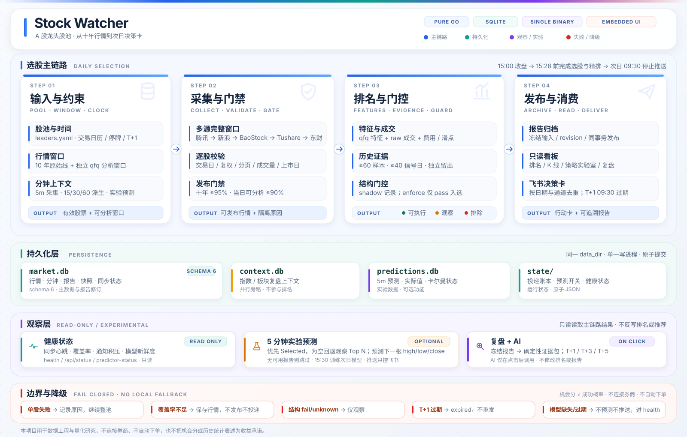

<h1 align="center">Trustworthy-stock-picker</h1>

<p align="center">
  <strong>A 股龙头股池 · 十年日线 · 多源回退 · 短线研究 · 内嵌看板</strong>
</p>

<p align="center">
  <a href="https://github.com/KrisMurdock/Trustworthy-stock-picker/actions/workflows/ci.yml"></a>
  <a href="https://go.dev/doc/devel/release"></a>
  
  
  <a href="LICENSE"></a>
</p>

<p align="center">
  <a href="https://github.com/KrisMurdock/Trustworthy-stock-picker"></a>
  <a href="https://github.com/KrisMurdock/Trustworthy-stock-picker/forks"></a>
  <a href="https://github.com/KrisMurdock/Trustworthy-stock-picker/issues"></a>
  <a href="https://github.com/KrisMurdock/Trustworthy-stock-picker/pulls"></a>
  <a href="https://github.com/KrisMurdock/Trustworthy-stock-picker/graphs/contributors"></a>
</p>

<p align="center">
  <a href="https://github.com/KrisMurdock/Trustworthy-stock-picker/commits/main"></a>
  
  
</p>

<p align="center">
  <a href="#快速开始">快速开始</a> ·
  <a href="#嵌入-go-项目">嵌入 Go</a> ·
  <a href="#核心能力">核心能力</a> ·
  <a href="#工作原理">工作原理</a> ·
  <a href="#配置">配置</a> ·
  <a href="#部署">部署</a> ·
  <a href="#开发与测试">开发与测试</a> ·
  <a href="#文档导航">文档导航</a> ·
  <a href="#license">License</a>
</p>

Stock Watcher 是一个用纯 Go 构建的 A 股研究型行情引擎。它从多个公开行情源同步龙头股池，校验交易日、复权窗口和十年历史完整性，将行情、报告与投递状态事务化保存到本地磁盘或挂载的 Windows/CIFS 共享盘上的 SQLite，并生成下一交易日的观察排名、短线研究结果、内嵌看板和飞书通知。

整个生产链路只有一个原生二进制：行情下载、数据校验、指标计算、策略研究、网页服务和消息投递都在同一进程内完成，不依赖 Python、Node.js、AKShare 或独立前端服务。

> [!NOTE]
> 本项目用于数据工程与量化研究，不构成投资建议。它不连接券商、不自动下单，也不会把研究排名描述为成功概率或收益承诺。

## 核心能力

- **纯 Go、单二进制**：没有解释器、子进程和隐藏兼容层；网页资源通过 `go:embed` 打包进程序。
- **多源行情回退**：默认按 `腾讯 → 新浪 → BaoStock → Tushare → 东方财富` 尝试完整数据窗口。
- **十年原始日线 + 复权分析窗口**：长期留存不复权价格，分析使用独立刷新的前复权窗口，不跨来源或跨轮拼接。
- **严格的数据完整性**：校验交易日历、上市日期、分页、复权口径、成交量单位和历史覆盖；覆盖率不足时不发布推荐。
- **SQLite 事务存储**：行情、同步状态、报告和投递账本保存在 `<data_dir>/market.db`；盘前高低价模型、预测与核对档案保存在独立 `<data_dir>/dayrange.db`。同一数据目录只允许一个写入进程。
- **可审计的全天高低价观察**：盘前生成当日最高/最低价点估计、分位数与区间，收盘后核对实际极值；未通过验证门禁时保留历史波幅基线，不进入正式推荐或飞书主卡。
- **可复核的短线研究**：前复权特征、真实费用与滑点、T+1 成交模拟、滚动验证和独立留出样本。
- **两层选股**：正式 `short_horizon_v1` 精排之外，另有独立的高召回第一层初筛；初筛结果作为精排候选参考，当前不改变正式推荐。
- **可维护的龙头股池**：`leaders.yaml` 当前包含 165 只沪深龙头，宇树科技、星网锐捷、亿联网络等已纳入，股池与运行参数分开维护。
- **5 分钟预测 + 全天高低价评估**：5 分钟实验预测已接入监控、网页和飞书；全天最高/最低价预测目前只有离线评估契约，尚未生产接入。
- **内嵌只读看板**：提供全池、个股 K 线、分钟周期、历史排名、复盘、策略实验室和仓位计算。
- **可恢复的通知投递**：飞书通道采用持久账本和至少一次语义，失败重试不会重新下载整池行情。
- **生产级运行约束**：默认本地存储，也可显式要求 CIFS；挂载盘不可用时拒绝本地回退。日志统一文本/JSON、stdout/文件双通道和滚动压缩。

## 快速开始

### 环境要求

- Linux、Go 1.26.4+、Git、GNU Make、Bash。
- 默认将行情与状态保存到当前目录的 `data/`（本地磁盘）；需要 Windows 共享盘时，先挂载并设置 `STOCK_WATCHER_DATA_DIR` 与 `STOCK_WATCHER_REQUIRE_CIFS=true`。
- 运行参数和凭证从 `.env` 环境变量读取；观测股池仍独立保存在 `leaders.yaml`。启动不再需要 `config.yaml` 或 `feishu.config`。
- Docker Engine 与 Compose ≥ 2.30.0 仅用于容器部署和容器验收。

### 构建与首次启动

```bash
git clone https://github.com/KrisMurdock/Trustworthy-stock-picker.git
cd Trustworthy-stock-picker

# 复制完整参数模板；按部署实际修改数据目录、CIFS 和通知配置
cp .env.example .env

# 直接运行 CLI 前加载环境变量；make run 会自动加载 .env
set -a
source .env
set +a

make build
./bin/stock-watcher check-config
./bin/stock-watcher init
./bin/stock-watcher check

# 首次部署：补齐十年停牌状态与交易所日历
./bin/stock-watcher status-backfill -as-of YYYY-MM-DD
./bin/stock-watcher status-audit -as-of YYYY-MM-DD

# 下载股票行情、指数与全量板块，校验覆盖率并保存报告
./bin/stock-watcher sync

# 首次部署补齐最近 200 个交易日的历史 5 分钟线（日线同步后运行）
./bin/stock-watcher backfill-minutes -workers 6
./bin/stock-watcher preview -as-of YYYY-MM-DD

# 前台运行监控、分钟采集、5 分钟预测与网页
make run
```

将 `YYYY-MM-DD` 替换为最近已完成的交易日。`check-config` 只校验配置、股池、凭证和日志设置，`check` 才检查数据库、交易日历和投递状态。首次部署或升级数据库 schema 后，必须先完成 `status-backfill`；未完成时 `sync` 和 `run` 会拒绝发布。

`make run` 启动后会先绑定网页端口，再执行启动同步。网页默认地址为 `http://127.0.0.1:8080/`；常驻进程按内置的 `daily.run_at`（默认北京时间 18:05）处理后续交易日。

## 嵌入 Go 项目

其他 Go 程序可以直接依赖本仓库的 `runtime` 包，复用配置加载、SQLite 存储、行情同步、调度、通知和只读看板，无需启动 `stock-watcher` 子进程。

```go
package main

import (
	"context"
	"log"
	"net/http"
	"os/signal"
	"syscall"

	stockwatcher "github.com/KrisMurdock/Trustworthy-stock-picker/runtime"
)

func main() {
	cfg, err := stockwatcher.LoadConfig()
	if err != nil {
		log.Fatal(err)
	}
	cfg.DataDir = "/srv/stock-watcher/data"
	cfg.PoolFile = ""
	cfg.Stocks = []stockwatcher.Stock{{Code: "sz000001", Name: "平安银行"}}
	cfg.Web.Enabled = false // 由宿主进程挂载看板 handler

	if _, err := stockwatcher.Init(&cfg); err != nil {
		log.Fatal(err)
	}
	logger, err := stockwatcher.NewLogger(stockwatcher.LoggerOptions{
		Dir: "logs", MaxBytes: 10 << 20, MaxDays: 7, Backups: 10, Color: "auto",
	})
	if err != nil {
		log.Fatal(err)
	}
	defer logger.Close()

	rt, err := stockwatcher.New(stockwatcher.Options{Version: "my-app", Config: &cfg, Logger: logger})
	if err != nil {
		log.Fatal(err)
	}
	defer rt.Close()

	mux := http.NewServeMux()
	mux.Handle("/", rt.DashboardHandler())

	ctx, stop := signal.NotifyContext(context.Background(), syscall.SIGINT, syscall.SIGTERM)
	defer stop()
	if err := rt.Run(ctx); err != nil {
		log.Fatal(err)
	}
}
```

`Runtime` 不接管 `os/signal`，由宿主控制退出；同一数据目录只允许一个写入实例。完整接口与生命周期说明见[作为 Go 库嵌入](docs/embedding.md)。

## 常用命令

| 命令 | 作用 | 写入数据 | 发送通知 |
| --- | --- | --- | --- |
| `check-config` | 校验内置配置、股池、凭证与日志参数 | 否 | 否 |
| `init` | 显式创建或迁移 `market.db`；启用时含 `dayrange.db` | 是 | 否 |
| `check` | 检查存储、日历、任务和投递状态 | 否 | 否 |
| `status-backfill` | 补齐股池十年停牌状态与交易所日历 | 是 | 否 |
| `status-refresh` | 刷新最近一段时间的证券状态 | 是 | 否 |
| `status-audit` | 只读审计交易日、停牌、缺口和可分析状态 | 否 | 否 |
| `sync` | 同步整池行情、指数与全量板块并生成报告 | 是 | 否 |
| `sync-context` | 只补跑指数与板块同步，用于排障 | 是 | 否 |
| `sync-intraday` | 手动执行一轮 5 分钟采集 | 是 | 否 |
| `backfill-minutes` | 用 BaoStock 或新浪补齐历史 5 分钟线，支持 staging 与断点续跑 | 是 | 否 |
| `train-predictor` | 在停止 `run` 后手动训练下一有效期模型 | 是 | 否 |
| `predictor-status` | 只读查看预测模型、开关和最近状态 | 否 | 否 |
| `predictor-eval` | 只读运行多训练窗口滚动评估，输出确定性 JSON | 否 | 否 |
| `train-dayrange [-as-of D] [-offline]` | 审计冻结数据、训练与校准盘前高低价模型；离线模式只写临时库 | 是 | 否 |
| `predict-dayrange [-as-of D] [-code C]` | 生成并保存下一交易日盘前高低价预测 | 是 | 否 |
| `reconcile-dayrange [-as-of D]` | 用完整日线核对预测目标日的实际高低价 | 是 | 否 |
| `status-dayrange [-as-of D]` | 只读查看模型、预测核对和评估状态 | 否 | 否 |
| `replay-dayrange [-as-of D] [-code C]` | 从已保存快照和模型重放预测，不重新训练 | 否 | 否 |
| `preview` | 输出全池观察排名和研究结果 | 否 | 否 |
| `research` | 输出研究统计 | 否 | 否 |
| `experiment` | 运行或派生策略实验 | 是 | 否 |
| `plan` | 按实际成交价和预算计算交易计划 | 否 | 否 |
| `run` | 常驻日线同步、分钟采集、5 分钟预测、调度和网页 | 是 | 是 |
| `once` | 执行一次受时间窗口约束的调度 | 是 | 是 |
| `status` | 查看各通道投递状态 | 否 | 否 |
| `retry` | 解锁指定通道或全部通道的永久错误 | 是 | 可能 |

`sync` 会在同一轮同步中并发下载整池股票、核心 A 股指数和东方财富可发现的所有行业/概念板块；指数或板块失败只记录在 `context.db` 的同步状态中，不阻断股票报告。`sync-context` 只用于单独补跑或排障，常规流程不需要手动执行。`sync` 不发送消息；`run` 和 `once` 才会执行调度与投递。常驻进程持有数据目录写锁，手动写入命令需要先停止常驻实例。修改股池、环境变量或凭证后需要重启。

## 工作原理

<p align="center">
  <a href="docs/assets/selection-flow.svg">
    
  </a>
</p>

图中上层为选股主链路，青绿层为持久化，紫色层为只读观察与实验功能，底部红色层为失败与降级边界。第一层初筛作为日报内的独立候选池输出，不进入正式 `Selected`；5 分钟预测优先读取当日 `Selected`，为空时回退观察 Top N，且不影响选股排名；`context.db` 只服务复盘上下文。点击图可查看原始 SVG。

一次完整同步遵循以下顺序：

1. 根据北京时间确定最近已完成交易日，跳过周末和内置交易日历中的节假日。
2. 按配置顺序尝试行情源，只有网络、供应商、权限、覆盖不完整等可回退错误才切换来源。
3. 校验上市日期、交易日缺口、复权口径、分页边界和成交量单位；可隔离错误逐股记录，临时性错误阻止本轮发布。
4. 整池遍历结束后事务化写入行情与同步状态；达到完整性覆盖率与当日可分析比例门槛后，才与报告同事务发布。
5. 生成观察排名、历史证据和结构门控结果；通过全部门槛的候选才成为可执行推荐，其余保留为观察候选或过滤原因。
6. 在正式排名之外计算 `first_stage` 高召回初筛：按“未来 3 个交易日最高价相对信号日收盘触及 +1%”的历史标签，将机会分与版本化 logistic 模型分等权融合；默认预算 145 只，只作为第二层精排的候选参考。
7. 报告归档后供只读看板、复盘与按需 AI 归因使用；投递账本按数据日期和通道去重，超过 T+1 窗口不再发送。
8. 指数与板块并行写入 `context.db`；失败不影响股票报告，也不参与选股排名。
9. 可选的 5 分钟预测优先读取当日 `Selected`，严格推荐为空时回退到同一报告的 Top N 观察排名；默认 15:30 训练下一交易日模型，训练与预测使用同一标的集合。预测结果实时推送；上一根实际值确认后，再单独推送一张偏差对比卡。没有可用结果、模型缺失或模型过期时不预测、不推送，推送开关只控制飞书投递，不停止预测落库。

## 数据与调度

- 默认行情源为 `tencent, sina, baostock, tushare, eastmoney`，可通过 `STOCK_WATCHER_MARKET_PROVIDERS` 调整。
- 每只有效股票保存至少最近十个自然年的不复权日线；上市不足十年的股票从上市日开始，不虚构上市前数据。
- 分析窗口由 `daily.history_days` 控制，默认 365 天，允许 90–7300 天；原始窗口取十年与分析窗口中更长者。
- 推荐要求十年完整性覆盖率默认不低于 95%，当日可分析覆盖率默认不低于 90%。
- 交易日 15:00 前使用上一已收盘交易日；目标买入日 09:30 后不再推送旧推荐。
- 内置交易日历当前覆盖 2026 年，必须在到期前按交易所新年度通知升级二进制。
- 默认使用本地 `data/` 目录；使用 Windows/CIFS 共享盘时设置 `STOCK_WATCHER_REQUIRE_CIFS=true`。挂载盘不可用时停止本轮写入，不回退到服务器本地目录。

行情源协议、分页、复权和回退细节见[数据源接入与回退](docs/data-sources.md)。

## 短线研究

内置配置默认启用全池短周期排名。核心假设如下：

- 信号日收盘后排名，下一交易日开盘价加单边滑点买入；开盘偏离、无成交、一字板或预算不足时不模拟买入。
- 主目标为扣费后的 **+3%**，单独统计 **+2.5%**；每笔扣费后净亏损必须严格低于 3%。
- 最早在买入后的下一交易日卖出，默认第 5 个交易日收盘到期，同时比较 1/3/5 日窗口。
- 特征使用前复权价格，成交模拟使用独立的不复权价格；费用包含佣金、过户费、印花税和滑点。
- 开发区间逐日更新历史证据，最近 40 个完整信号日作为验证区间；独立留出区间通过 `-holdout` 单次消费。
- 推荐要求至少 60 个买入样本、40 个不同信号日、正的平均净收益、优于全池的达标率，以及满足机会分和波动门槛。
- 另有一个独立的“上涨延续分”：只在信号日上涨时，统计同规则历史样本中次日收盘继续高于信号日收盘的比例，并用保守下界展示；首版不并入机会分，避免未经独立验证的权重改变正式排名。

未通过推荐门槛时仍会生成观察排名，并明确展示缺失样本、未决交易、收益不足或风险超限的原因。统计门槛不是对未来收益的承诺，详见[推荐门槛诊断](docs/strategy-diagnostics.md)。

日报还包含独立的 `first_stage` 高召回初筛：以“未来 3 个交易日最高价相对信号日收盘触及 +1%”为历史标签，将机会分日内排名与版本化 logistic 模型分等权融合，默认预算 145 只，推送开启时只展示综合分前 30 名并合并为一张飞书卡片，但第二层精排使用全部候选。3 个交易日窗口结束后，初筛机器人会追加窗口回看卡，分别展示全部候选召回率、Top 30 覆盖率与 Top 30 精确率，并按信号日与窗口结束日稳定去重。回看会从初筛报告还原当时股池，避免后续股池调整污染召回率。初筛只生成第二层精排的候选参考，不改变 `Selected`、`Ranking`、结构门控或风险门槛；初筛失败只写入 `first_stage.status=failed`，不阻断主报告。

日线推荐还会读取已保存的完成 5 分钟线，派生 15/30 分钟结构并记录旧 5/15/30 诊断；该诊断只作对照，不改变正式结论。生产结构判断使用 `structure_guard`：`shadow` 模式只输出观察排名和结构通过排名，不产生可执行推荐；`enforce` 模式下只有日线结构通过池内的可入选候选才能成为正式推荐。`structure_guard=pass` 只表示未被结构过滤，不是买点。飞书主卡用原生表格展示 Top10 的结论、价格和主要风险；详情卡按页补齐“结构门控”、“旧 5/15/30 诊断”、匹配规则和“评分推导”，后者给出基础分、日线评分贡献、加减分项、历史证据融合及最终机会分的算式。

```bash
./bin/stock-watcher sync -as-of YYYY-MM-DD
./bin/stock-watcher preview -as-of YYYY-MM-DD
./bin/stock-watcher research -as-of YYYY-MM-DD
./bin/stock-watcher experiment -policy baseline
./bin/stock-watcher plan -code sz000001 -entry-price 10
```

`plan` 只根据输入成交价和预算推算数量、成本、净止盈价和净止损价，不读取实时盘口，也不代表实际可成交价格。

## 网页看板

网页由 Go `embed` 打包，随 `run` 一起启动，不需要独立前端进程或外部图表 CDN。

| 页面 | 用途 |
| --- | --- |
| `/` | 已完成交易日、覆盖率、筛选数量和导航摘要 |
| `/stocks` | 全股池搜索、行业/数据状态筛选与排序 |
| `/chart` | 日 K、成交量、MA5/10/20、前复权/不复权切换和分钟周期 |
| `/rankings` | 当前及历史日推排名、5 分钟实验预测与本地推送开关 |
| `/day-range` | 盘前全天高低价预测、区间、模型与核对状态；阶段六盘中更新明确标注未实现 |
| `/experiments` | 策略实验室、父子实验、样本对比和固定数据快照 |
| `/review` | 冻结推荐回看、T+1/T+3/T+5 检查点、证据详情和手动 AI 归因 |
| `/calculator` | 浏览器内仓位、持仓、剩余风险与净止盈价计算 |

行情、报告、复盘、分钟预测和全天高低价预测的读取接口只读，包括 `/healthz`、`/api/dashboard`、`/api/reports?as_of=YYYY-MM-DD`、`/api/history?code=sz000001`、`/api/intraday?code=sz000001&period=5`、`/api/predictions?date=YYYY-MM-DD`、`/api/predictor`、`/api/day-range?date=YYYY-MM-DD`、`/api/day-range/status` 和 `/api/day-range/evaluation?date=YYYY-MM-DD`。写入口仅有受保护的 `PUT /api/predictor/config`（飞书预测推送开关）以及 loopback/同源约束下的 LLM 配置与对话/归因接口；公网匿名模式会拒绝全部非 GET/HEAD 请求。摘要页和股票页每分钟刷新，刷新不会触发行情下载或消息推送。

网页没有内置账号或权限系统，默认仅监听 `127.0.0.1:8080`。远程访问必须使用受控网络或已有认证反向代理；代理应保留根路径、`/api/` 和 `/assets/`。

### 家用机器临时公网入口

没有公网 IP、域名或云服务器时，可显式设置 `STOCK_WATCHER_PUBLIC_TUNNEL_ENABLED=true` 后运行 `make run`。该开关默认 `false`，不会自动开放公网；开启后要求本机已安装 `cloudflared`，启动匿名只读网页和 Cloudflare Quick Tunnel，并打印临时 HTTPS 地址，不需要路由器端口转发。脚本强制只允许 GET/HEAD，关闭 AI、Predictor 推送和飞书配置入口，地址也会写入 `.scratch/public-tunnel/url`。

Quick Tunnel 的地址在进程重启、机器休眠或隧道重连后可能变化，且没有可用性承诺。公网只读模式不是账号认证；不要把它当作长期生产部署。长期稳定入口需要自有域名和命名隧道，或认证反向代理。

## 配置

生产配置全部来自环境变量。根 `.env.example` 已包含完整参数、行情源、日志和 Docker 部署示例；复制为 `.env` 后即可启动，不需要额外 YAML 或凭证文件。观测股池独立保存在 `leaders.yaml`，不内联到 `.env`。

| 文件 / 变量 | 作用 |
| --- | --- |
| `.env` | 私有运行环境；不得提交，生产权限建议 `600` |
| `leaders.yaml` | 运行时加载的已确认观测股池；可独立维护大量股票 |
| `leaders.pending.yaml` | 待人工确认名单，不参与启动或选股 |
| `STOCK_WATCHER_POOL_FILE` | 股池路径，默认 `leaders.yaml` |
| `STOCK_WATCHER_DATA_DIR` | 行情与状态目录；默认本地 `data`，也可指向已挂载的 CIFS |
| `STOCK_WATCHER_REQUIRE_CIFS` | 是否强制数据目录位于 CIFS；默认 `false`，共享盘模式设为 `true` |
| `STOCK_WATCHER_WEB_ADDR` | 网页监听地址，默认 `127.0.0.1:8080` |
| `STOCK_WATCHER_WEB_PUBLIC_READ_ONLY` | 公网匿名模式；只允许 GET/HEAD 并隐藏 AI 与预测写入口 |
| `STOCK_WATCHER_PUBLIC_TUNNEL_ENABLED` | 临时 Cloudflare 公网隧道启动开关，默认 `false`；只由 `make run` 启动器读取 |
| `STOCK_WATCHER_FEISHU_ENABLED` | 是否启用飞书投递 |
| `FEISHU_WEBHOOK` / `FEISHU_SECRET` | 飞书 webhook 与可选签名密钥，只从环境读取 |
| `STOCK_WATCHER_NOTIFY_CHANNELS` | 命名飞书通道及阶段路由；可按初筛、精筛、实时预测和当日预测分流 |
| `STOCK_WATCHER_FEISHU_CREDENTIALS_FILE` | 显式设置时才启用旧 `feishu.config` 兼容 |
| `STOCK_WATCHER_STRATEGY_ENABLED` | 是否启用全池短周期排名 |
| `STOCK_WATCHER_FIRST_STAGE_ENABLED` | 是否计算高召回第一层初筛；要求 `daily_adjust=qfq` |
| `STOCK_WATCHER_FIRST_STAGE_PUSH_ENABLED` | 是否推送初筛池飞书卡；关闭后仍计算 |
| `STOCK_WATCHER_FIRST_STAGE_BUDGET` | 初筛候选上限，默认 `145` |
| `STOCK_WATCHER_INTRADAY_ENABLED` | 是否启用 5 分钟采集 |
| `STOCK_WATCHER_PREDICTOR_ENABLED` | 是否启用 5 分钟实验预测 |
| `STOCK_WATCHER_PREDICTOR_PUSH_ENABLED` | 是否推送聚合预测卡；关闭后仍保存预测 |
| `STOCK_WATCHER_PREDICTOR_TRAIN_AT` | 收盘后训练时间，默认 `15:30` |
| `STOCK_WATCHER_DAYRANGE_ENABLED` | 是否启用盘前全天高低价模型与 `/day-range` 页面；默认 `false` |
| `STOCK_WATCHER_MARKET_PROVIDERS` | 逗号分隔的行情源顺序 |
| `TUSHARE_TOKEN` | 可选 Tushare Token；缺失时跳过 Tushare |

完整变量、默认值、股池格式和 systemd/Compose 加载差异见[环境变量](docs/environment-variables.md)。凭证只来自环境变量，日志不会输出 webhook、secret 或 Token。

## 部署

原生、systemd 与容器都直接运行同一个 Go CLI。同一数据目录同时只允许一个写入实例。

### 原生或 systemd

```bash
make build
./bin/stock-watcher version
./bin/stock-watcher check

sudo install -m 644 deploy/stock-watcher.service /etc/systemd/system/stock-watcher.service
sudo systemctl daemon-reload
sudo systemctl enable --now stock-watcher.service
sudo systemctl status stock-watcher.service
```

服务模板读取 `/etc/stock-watcher.env`，工作目录和二进制路径按实际安装位置调整。完整准备、SELinux、升级、回滚和排障步骤见[部署与排障](docs/deployment.md)。

### Docker Compose

```bash
make image
make docker-smoke
```

Compose 将宿主机数据目录（本地磁盘或 CIFS 挂载）映射到 `/data`、日志映射到 `/logs`，容器监听 `0.0.0.0:8080`，宿主机默认只绑定 `127.0.0.1:8080`。容器根文件系统只读，仅 `/data` 和 `/logs` 可写。操作步骤见[Compose 部署](docker/README.md)。

发布前记录完整提交 SHA、镜像标识或发布包校验和。镜像 tag 建议使用提交 SHA，部署后用真实 URL 验证健康检查、页面、API、权限边界和退出行为。

## 开发与测试

### 构建门禁

| 命令 | 内容 |
| --- | --- |
| `make fmt-check` | Go 格式检查 |
| `make vet` | `go vet ./...` |
| `make test` | `go test -race ./...` |
| `make smoke` | 真实 CLI、脚本和仓位计算模型 |
| `make sources-smoke` | 本地 HTTP/TCP 模拟行情源与回退 |
| `make intraday-smoke` | 分钟采集、schema 迁移、只读 API 和 SIGTERM |
| `make dashboard-smoke` | 真实 Chromium 页面、DOM、URL、网络和错误恢复 |
| `make docker-smoke` | 容器 CLI、权限、Compose 健康检查和生命周期 |
| `make docker-dashboard-smoke` | 容器形态浏览器验收 |
| `make ci` | 格式、静态检查、竞态测试、构建、CLI/行情/分钟冒烟和发布包 |
| `make package` | Linux 发布包；`BUILD_GOARCH=amd64` 或 `arm64` |

浏览器测试额外需要 Python 3.12 与 Playwright Chromium，策略模型测试需要 Node.js 20+；这些依赖不属于生产运行时。资源紧张时可使用 `GOMAXPROCS=2 GOFLAGS=-p=2 make ci`。

### 项目结构

| 路径 | 职责 |
| --- | --- |
| `cmd/stock-watcher` | 唯一生产入口和命令编排 |
| `runtime` | 可被其他 Go 项目导入的运行时、初始化与看板 handler |
| `cmd/bottom-study` | 底部形态与止损/持有期研究工具 |
| `cmd/resolve-pool` | 股池名称与代码核对辅助工具 |
| `internal/config` | 内置生产配置、环境变量覆盖和严格校验 |
| `internal/calendar` | 北京时间交易日、节假日、T+1 与过期窗口 |
| `internal/market` | 行情源协议、分页、复权、超时与回退 |
| `internal/storage` | 本地/CIFS 存储策略、SQLite、原子状态与只读看板查询 |
| `internal/monitor` | 整池同步、启动刷新、调度、重试和账本迁移 |
| `internal/selection` | 趋势筛选与报告事件组装 |
| `internal/firststage` | 高召回第一层初筛、版本化 logistic 模型和初筛报告 |
| `internal/strategy` | 前复权特征、成交模拟、排名、滚动验证和留出样本 |
| `internal/predictor` | 5 分钟 pooled GBDT、特征、卡尔曼趋势、预测库与投递 |
| `internal/marketcontext` | 指数与行业/概念板块上下文同步和独立 `context.db` |
| `internal/review` / `internal/advisor` | 冻结推荐复盘投影与基于证据的只读 AI 分析 |
| `internal/dayrange` | 盘前高低价数据审计、确定性树模型、区间校准、预测/核对与评估 |
| `internal/dashboard` | 内嵌 HTML/CSS/JavaScript、SVG K 线和只读 API |
| `internal/notify` | 版本化消息、通道接口和投递账本 |
| `internal/feishu` | 卡片、签名、HTTP/业务码确认和错误分类 |
| `internal/logging` | 调用位置、脱敏、stdout/滚动文件和文本/JSON 输出 |
| `tests/` | CLI、容器、行情源、分钟和浏览器冒烟 |
| `docs/` | 部署、配置、算法契约和用户功能文档 |

## 文档导航

| 主题 | 文档 |
| --- | --- |
| 嵌入与集成 | [作为 Go 库嵌入](docs/embedding.md) |
| 环境与配置 | [环境变量](docs/environment-variables.md) · [工程结构](docs/repository-layout.md) |
| 数据与运行 | [行情来源与回退](docs/data-sources.md) · [部署与排障](docs/deployment.md) |
| 看板视觉 | [深色主题与环境层 3D](docs/dashboard-visual-design.md) |
| 开发与发布 | [开发、CI 与发布包](docs/development.md) · [测试范围](tests/README.md) |
| 策略研究 | [推荐门槛诊断](docs/strategy-diagnostics.md) · [策略实验室](docs/experiments.md) · [实验快照](docs/experiment-result-snapshots.md) |
| 选股算法 | [算法接入契约](docs/algorithm-interface.md) |
| 5 分钟预测 | [5 分钟价格预测](docs/minute-predictor.md) |
| 全天高低价预测 | [开发路线与当前边界](docs/dayrange-roadmap.md) · [评估指标契约](docs/dayrange-evaluation.md) |
| 研究与工具 | [单股价格策略](docs/单股价格策略.md) · [底部形态](docs/bottom-signals.md) |
| 容器 | [Compose 部署与升级](docker/README.md) |

## 已知边界

- 仅覆盖沪深 A 股，不提供逐笔行情、盘口深度或自动交易。
- 日线来自多个上游，分钟线当前只采集腾讯 5 分钟原始线并派生 15/30/60 分钟；上游窗口和修订规则可能变化。
- 高召回初筛只用于第二层候选，历史召回率和模型分都不代表未来收益；它不改变正式推荐，初筛失败也不会阻断主报告。
- 全天最高/最低价预测已接入盘前模型、区间校准、CLI、网页、调度和 `predictor_dayrange` 飞书推送；阶段六盘中剩余时段模型尚未实现，网页不会把盘前结果当作盘中更新。
- 内置交易日历当前覆盖 2026 年，过期后必须升级；测试覆盖变量不得用于生产。
- 网页没有账号或角色体系；本地默认只允许受保护的预测推送开关、LLM 配置和同源/回环 AI 请求写入，公网匿名模式会拒绝全部写请求。远程暴露必须依赖受控网络或已有认证代理。
- 飞书投递为至少一次语义，请求成功后、确认落盘前崩溃可能产生重复消息。
- 共享盘故障、临时网络错误或数据覆盖不足时，本轮不会发布缓存推荐；已有数据保留等待重试。
- 研究结果受样本、费用假设、流动性和成交边界影响，历史统计不代表未来收益。

## 贡献

欢迎提交问题、文档修正和代码改进。提交 PR 前建议：

1. 从最新 `main` 创建独立分支，控制改动范围。
2. 运行受影响的单元/集成测试；行为变化至少运行 `make ci`，前端变化另跑 `make dashboard-smoke`。
3. 不提交凭证、行情数据库、日志、浏览器截图或私有环境文件。
4. 在 PR 中说明改动、用户可见行为和验证命令；详细规范见[贡献指南](CONTRIBUTING.md)，并使用仓库的 [PR 模板](.github/pull_request_template.md)。

## License

本项目采用 [Apache License 2.0](LICENSE)。提交贡献即表示同意按该许可证授权。

---

如果这个项目对你有帮助，欢迎通过 Issue 分享使用场景、数据源问题和策略验证结果。

## Star 历史

[](https://star-history.com/#KrisMurdock/Trustworthy-stock-picker&Date)
